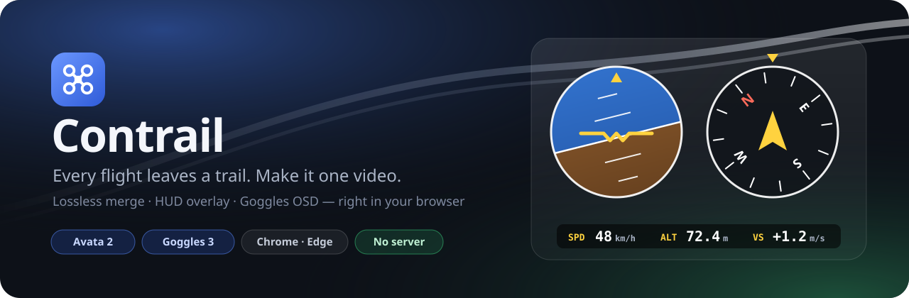
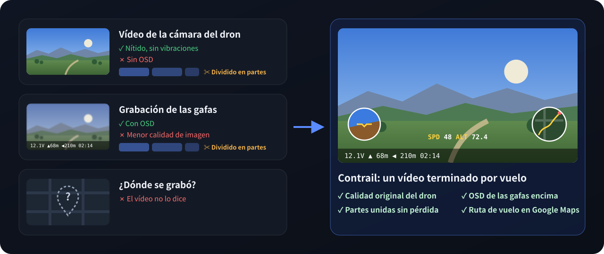
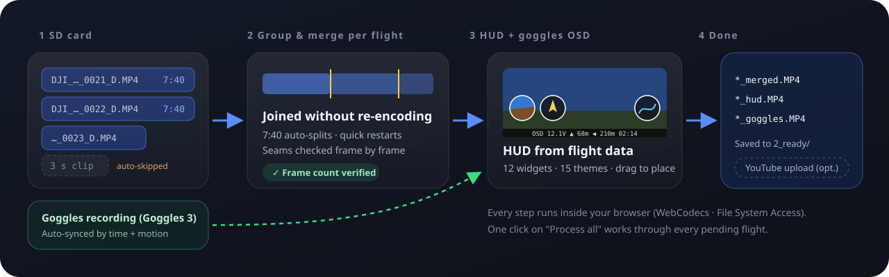
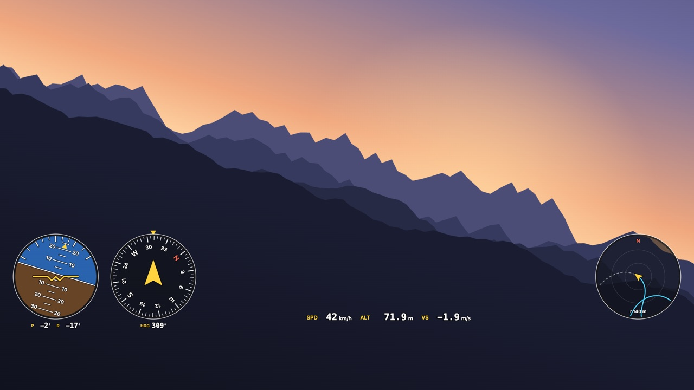
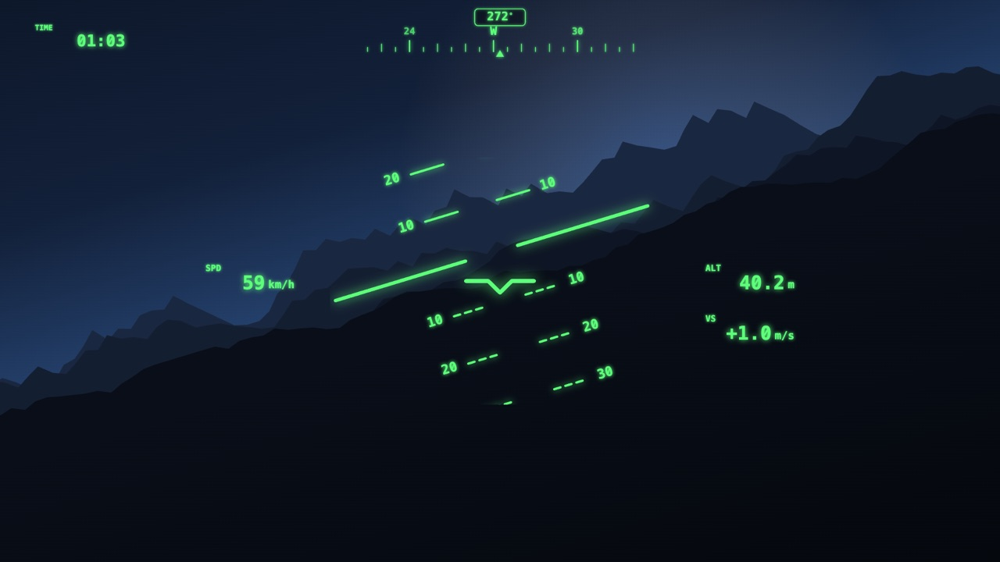
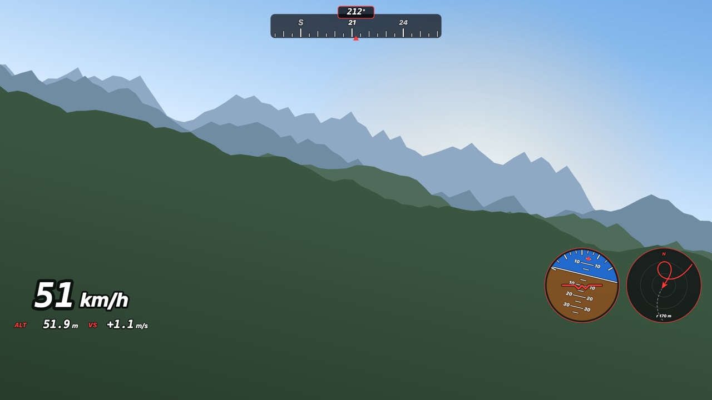
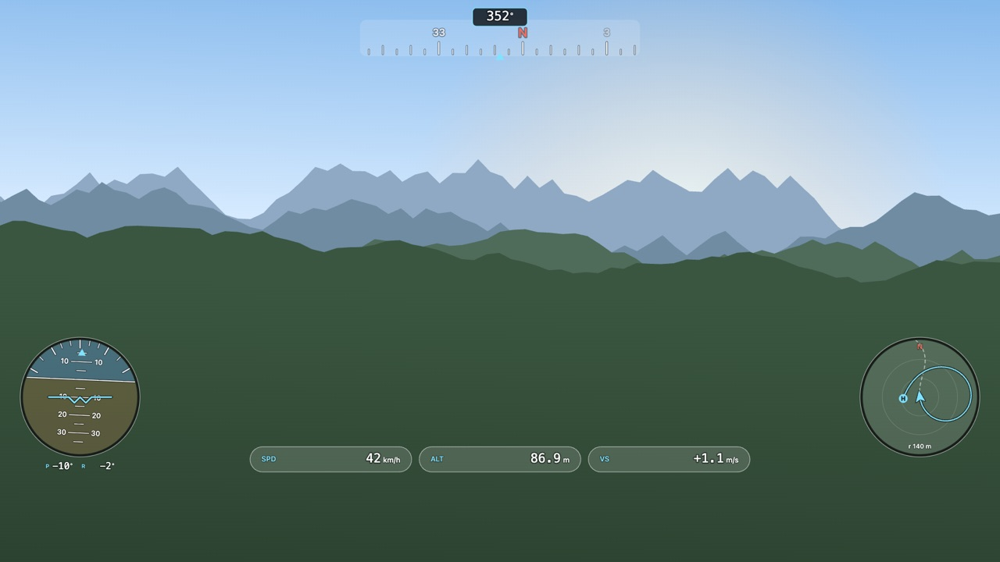
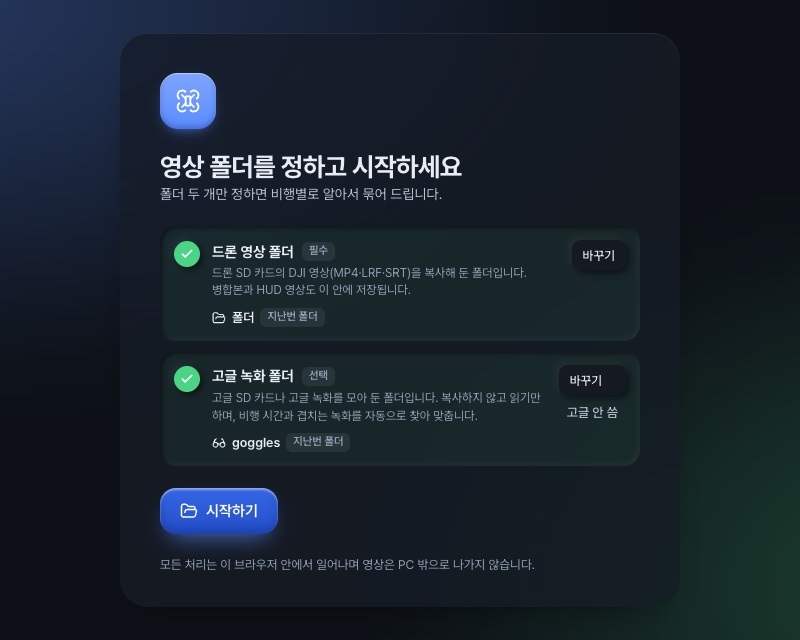

<p align="center">
  
</p>

<p align="center">
  <a href="README.md">English</a> · <a href="README.ko.md">한국어</a> · <a href="README.zh.md">简体中文</a> · <a href="README.ja.md">日本語</a> · <b>Español</b> · <a href="https://contrail.ouwork.io"><b>Abrir la app →</b></a>
</p>

<p align="center">
  
  
  
  
  
</p>

**Contrail** (estela de condensación) convierte el rastro que deja cada vuelo en un único vídeo terminado. Toma los clips repartidos por la tarjeta SD del dron, **los agrupa y los une por vuelo**, **dibuja un HUD** con los datos de vuelo incrustados en el vídeo y **superpone el OSD de la grabación de las gafas**.
No hay nada que instalar ni ningún servidor. El navegador lee y escribe directamente en tu carpeta local, y tus vídeos nunca salen de tu ordenador.

> El objetivo principal es **DJI Avata 2 + DJI Goggles 3**. La app se ha desarrollado y verificado con grabaciones reales de ambos dispositivos.
> Otros drones y gafas pueden funcionar si sus archivos tienen una estructura parecida. Comparte una muestra y podremos ampliar la compatibilidad. Consulta [Contribuir](#contribuir).

<br>

## Origen del proyecto

<p align="center">
  
</p>

Vuelo un DJI Avata 2 con las Goggles 3, y cada vuelo me deja dos grabaciones, pero ninguna está completa:

- **El vídeo del propio dron** es nítido y estable, sin vibraciones, pero **no tiene OSD**.
- **La grabación de las gafas** tiene el OSD, pero con menos calidad de imagen.
- **Ambas se dividen** en varios archivos cuando la grabación supera cierta duración, así que hay que volver a unir cada vuelo a mano.
- **El vídeo no dice dónde se grabó.** Quería dibujar la ruta de vuelo en un minimapa de Google Maps para que cada vídeo llevara su propia ubicación.

Contrail lo hace todo de una vez: une las partes sin pérdida, coloca el OSD de las gafas sobre la imagen limpia del dron y dibuja un HUD con la ruta en el mapa a partir de los datos de vuelo que el vídeo ya contiene.

<br>

## Qué hace

<p align="center">
  
</p>

- **Unión sin pérdida por vuelo.** Junta en un solo vuelo los archivos que se cortan automáticamente cada 7:40 y los clips que reiniciaste enseguida. Sin recodificar, y el resultado se verifica por número de fotogramas. Puedes revisar cualquier unión y dividir o descartar clips tú mismo.
- **HUD superpuesto.** Los instrumentos se dibujan con la actitud, el rumbo, la velocidad, la altitud y el GPS guardados dentro del archivo de vídeo. Hay 12 widgets, 15 temas y 8 plantillas de diseño. Los colocas arrastrándolos sobre el reproductor y se ajustan a bordes, espaciados y tangencias entre círculos.
- **OSD de las gafas.** Las grabaciones de las Goggles 3 se **sincronizan automáticamente** por marca de tiempo y correlación de movimiento. Solo se recorta el OSD y se coloca sobre la imagen del dron a calidad completa; los tramos con menús o avisos se omiten.
- **Resumen del registro de vuelo.** Lee la cabecera de `DJIFlightRecord_*.txt` y asocia a cada vídeo el tiempo de vuelo, la distancia y la altitud/velocidad máximas. Solo se lee la cabecera, porque el cuerpo está cifrado.
- **Procesar todo.** Un botón une todos los vuelos pendientes y renderiza los vídeos con HUD, uno tras otro. Puedes cancelar en cualquier momento, y si un vuelo falla los demás continúan.
- **Subida a YouTube (opcional).** Permanece oculta a menos que la actives en Ajustes.

<br>

## Galería de HUD

<table>
  <tr>
    <td width="50%"><br><sub><b>Clásico</b> · indicadores inferiores</sub></td>
    <td width="50%"><br><sub><b>HUD de caza</b> · escalera de cabeceo</sub></td>
  </tr>
  <tr>
    <td width="50%"><br><sub><b>Carreras</b> · velocímetro grande</sub></td>
    <td width="50%"><br><sub><b>Cristal</b> · esquinas</sub></td>
  </tr>
</table>

<sub>Estas imágenes se generaron con el código de dibujo de HUD real de la app (`src/hud.ts`), usando datos de vuelo simulados sobre un fondo dibujado. Con una clave de Google Map Tiles API, el minimapa muestra imágenes de satélite.</sub>

<br>

## Primeros pasos



**Necesitas:**
- **Chrome** o **Edge** de escritorio. La app usa la File System Access API y WebCodecs, así que Firefox y Safari aún no son compatibles.
- Una carpeta con los archivos `DJI_*.MP4` copiados de la tarjeta SD del dron.
- Opcionalmente, la tarjeta SD de las gafas o una carpeta con sus grabaciones.

**Pasos:**
1. Abre la app y elige tu **carpeta de vídeos del dron**, y también la de las gafas si la tienes.
2. Los clips se agrupan en vuelos. Abre un vuelo para previsualizar el resultado unido en el reproductor.
3. Ajusta los instrumentos en la pestaña **HUD** y la zona del OSD en la pestaña **Gafas**. Los cambios se guardan al instante y Ctrl+Z los deshace.
4. Pulsa **Unir y crear superposición**, o **Procesar todo** en la biblioteca.

Los vídeos terminados se guardan en `2_ready/` dentro de tu carpeta. Los originales nunca se borran: se mueven a `_sources/`.

<br clear="right">

<details>
<summary><b>Estructura de carpetas</b> (la crea la app)</summary>

| Ruta | Significado |
|---|---|
| `<carpeta>/` | Pendiente de unir. Copia aquí los `DJI_*.MP4/.LRF/.SRT` de la tarjeta SD |
| `2_ready/` | Vídeos terminados (`*_merged.MP4`, `*_hud.MP4`, `*_goggles.MP4`) + datos de vuelo `*.telemetry.json` |
| `3_uploaded/` | Vídeos ya subidos a YouTube (si la subida está activada) |
| `_sources/` | Originales usados en una unión (nunca se borran) |
| `_excluded/` | Clips cortos descartados |
| `goggles/` | Grabaciones de las gafas (copiadas con "Añadir vídeos de las gafas" o colocadas a mano) |
| `FlightRecords/` | (opcional) Registros de vuelo `DJIFlightRecord_*.txt` |
| `dji_state.json` | Selecciones manuales, ajustes por vuelo, emparejamientos con las gafas |

</details>

<br>

## Privacidad

- El vídeo, los datos de vuelo y la ubicación se procesan **solo dentro de tu navegador**. La app no tiene servidor.
- Solo dos funciones pueden hacer peticiones de red, y ambas hay que activarlas:
  - **El minimapa de satélite** descarga de Google los mosaicos del área de vuelo cuando añades una clave de Map Tiles API.
  - **La subida a YouTube** envía los vídeos que elijas cuando la activas y conectas una cuenta de Google.

<br>

## Desarrollo

```sh
pnpm install
pnpm dev        # http://localhost:5173
pnpm test       # pruebas unitarias (las que necesitan vídeo real solo se ejecutan si DJI_TEST_DIR está definido)
pnpm build      # comprobación de tipos + compilación estática → dist/
```

`dist/` se puede desplegar en cualquier alojamiento estático que sirva HTTPS. Copia `.env.example` a `.env` para definir los valores por defecto del mapa y la subida.
Los valores `VITE_` se incluyen tal cual en el paquete, así que **restringe las claves de API por referente HTTP**. Los usuarios también pueden introducir las claves en los Ajustes de la app.

<details>
<summary><b>Recorrido por el código</b></summary>

| Archivo | Qué hace |
|---|---|
| `src/mp4.ts` | Analizador y multiplexor MP4 mínimo. Une las muestras sin recodificar |
| `src/plan.ts` | Reglas que agrupan los clips en vuelos y deciden uniones/exclusiones (funciones puras) |
| `src/telemetry.ts` | Metadatos `djmd` del vídeo (protobuf) → datos de vuelo por fotograma |
| `src/hud.ts` · `src/map.ts` | Dibujo de widgets, temas y minimapa del HUD |
| `src/render.ts` | Decodificación WebCodecs → composición en canvas → codificación H.264 → MP4 |
| `src/goggles.ts` · `src/sync.ts` | Emparejamiento y sincronización temporal de las grabaciones de las gafas |
| `src/osdkey.ts` · `src/osdstat.ts` | Conservar solo el OSD de la imagen de las gafas |
| `src/flightlog.ts` | Lector del resumen del registro de vuelo (v6–v14) |
| `src/snap.ts` | Ajuste magnético del editor de diseño |
| `src/library.ts` · `src/store.ts` | Carpeta → modelo de vuelos, archivo de estado |
| `src/ui/*` | Pantallas (Preact) |

</details>

El comportamiento detallado (reglas de agrupación, sincronización de las gafas, recorte del OSD, salvaguardas de renderizado) está documentado en coreano en [docs/ARCHITECTURE.md](docs/ARCHITECTURE.md).

<br>

## Contribuir

La colaboración y las contribuciones son **siempre bienvenidas**, y no tienen por qué ser código:

- **Muestras de otros drones o gafas** (Mini, Air, Mavic, Neo, Goggles 2, Goggles N3…). Incluso una grabación corta ayuda.
- **Informes de errores.** Indica la versión del navegador, los modelos de dron y gafas y qué pulsaste. Lo más útil es pegar lo que copia el botón "Copiar detalles del error" de la pantalla de error de la app.
- **Traducciones.** La interfaz de la app está disponible hoy en coreano e inglés (`src/i18n.ts`).
- **Ideas de temas y widgets para el HUD**, mejoras de la documentación y comentarios.

Consulta [CONTRIBUTING.md](CONTRIBUTING.md).

<br>

## Hoja de ruta

- [ ] Guía para el primer uso y aviso de navegador no compatible
- [x] Despliegue estático público ([contrail.ouwork.io](https://contrail.ouwork.io))
- [ ] Compatibilidad con más drones y gafas de DJI
- [ ] Renderizado rápido de una vista previa en baja resolución
- [ ] Lectura del cuerpo del registro de vuelo (sticks, batería). Requiere una clave de aplicación de DJI

<br>

## Agradecimientos

- [telemetry-parser](https://github.com/AdrianEddy/telemetry-parser) sirvió de referencia para la estructura de los metadatos `djmd` de DJI.
- [dji-log-parser](https://github.com/lvauvillier/dji-log-parser) sirvió de referencia para el formato del registro de vuelo.
- [Pretendard](https://github.com/orioncactus/pretendard), [Lucide](https://lucide.dev) y [Preact](https://preactjs.com)

## Licencia

[MIT](LICENSE)

DJI, Avata y DJI Goggles son marcas comerciales de SZ DJI Technology Co., Ltd. Este es un proyecto no oficial y no está afiliado a DJI.
