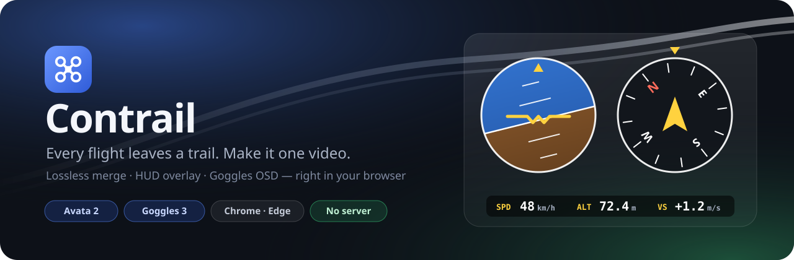
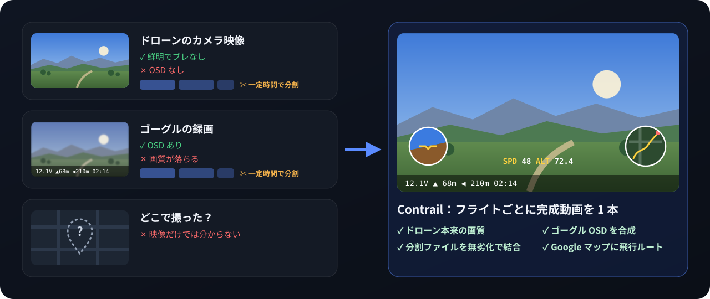
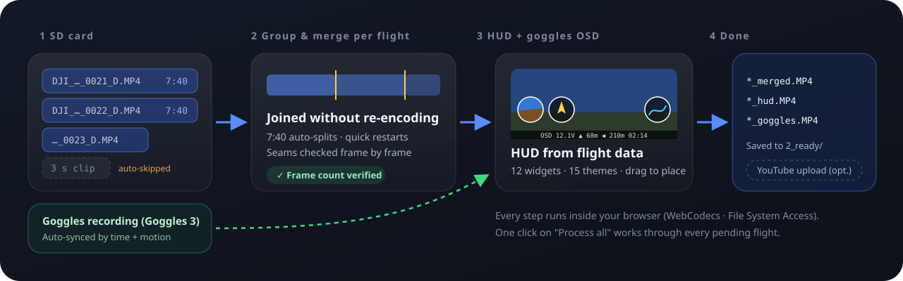
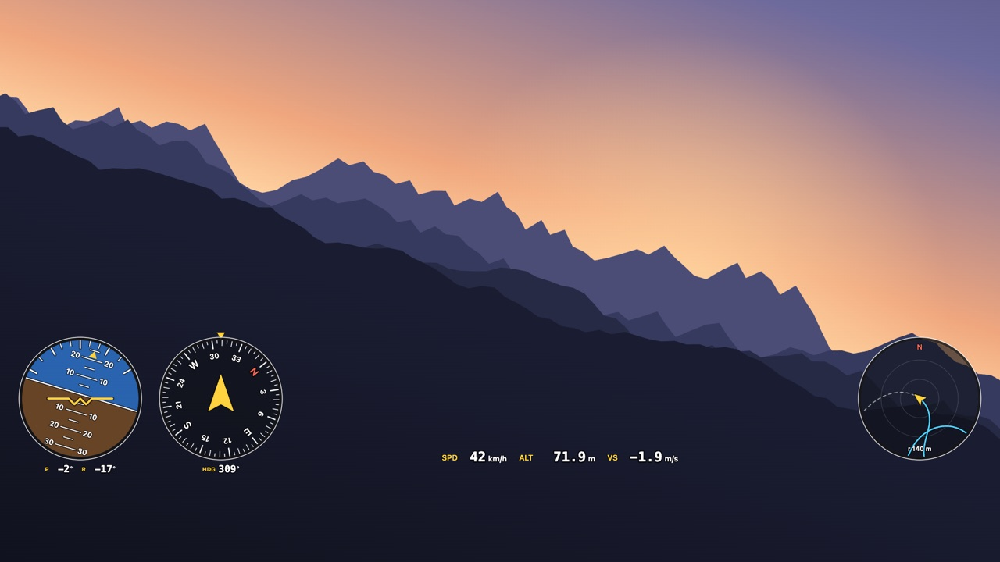
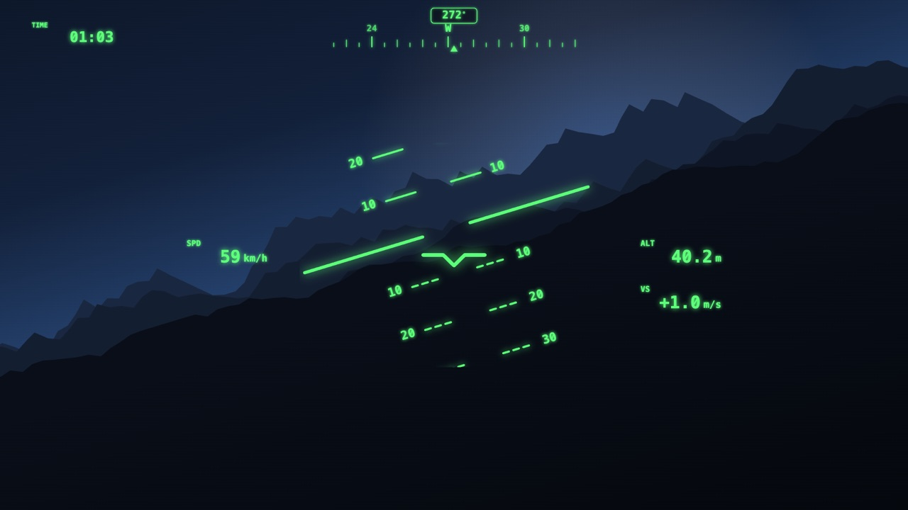
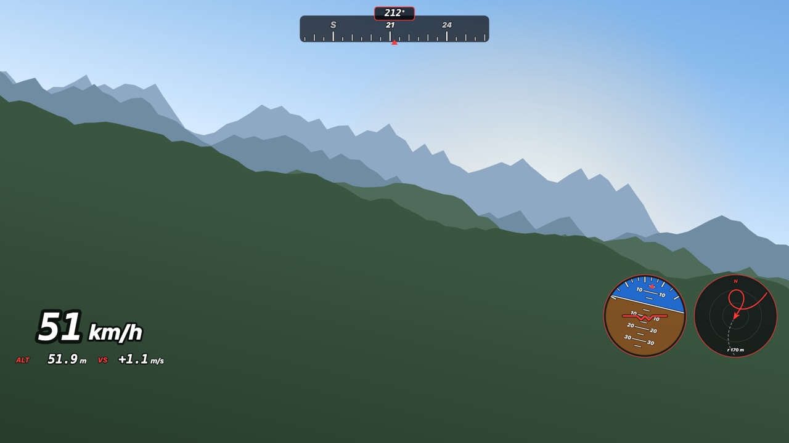
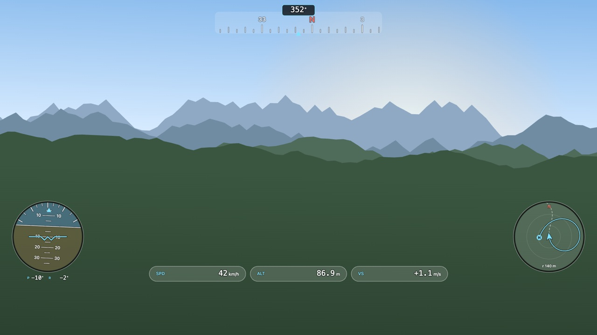
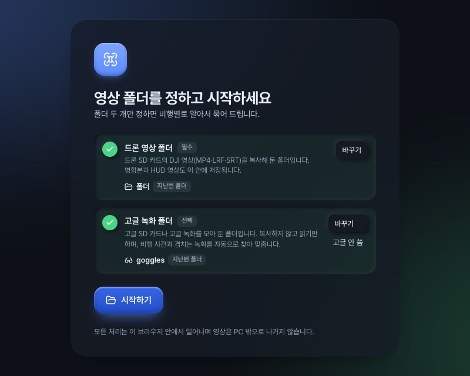

<p align="center">
  
</p>

<p align="center">
  <a href="README.md">English</a> · <a href="README.ko.md">한국어</a> · <a href="README.zh.md">简体中文</a> · <b>日本語</b> · <a href="README.es.md">Español</a> · <a href="https://contrail.ouwork.io"><b>アプリを開く →</b></a>
</p>

<p align="center">
  
  
  
  
  
</p>

**Contrail**（コントレイル、飛行機雲）は、フライトが残した軌跡を 1 本の完成動画にします。ドローンの SD カードに散らばったクリップを**フライト単位でまとめて結合**し、動画に埋め込まれた飛行データから **HUD 計器を描き**、さらに**ゴーグル録画の OSD** を合成します。
インストールもサーバーも不要です。ブラウザが PC のフォルダを直接読み書きし、映像が PC の外に出ることはありません。

> 主な対象は **DJI Avata 2 + DJI Goggles 3** です。両機種の実際の録画で開発・検証しています。
> 他の機体やゴーグルも、ファイル構造が似ていれば動作する可能性があります。サンプルを共有していただければ対応を広げられます。[コントリビュート](#コントリビュート)をご覧ください。

<br>

## Contrail 制作の背景

<p align="center">
  
</p>

DJI Avata 2 と Goggles 3 で飛ぶと、フライトのたびに録画が 2 つ残りますが、どちらも完全ではありません。

- **ドローン本体の映像**は鮮明でブレもありませんが、**OSD がありません**。
- **ゴーグルの録画**には OSD がありますが、画質が落ちます。
- **どちらも**一定時間を超えると**ファイルが分割される**ため、フライトごとに手作業でつなぎ直す必要があります。
- **映像だけでは、どこで撮ったのか分かりません。** Google マップのミニマップに飛行ルートを残し、動画ごとに場所が分かるようにしたいと考えました。

Contrail はこれを一度に処理します。分割ファイルを無劣化で結合し、鮮明なドローン映像にゴーグルの OSD を重ね、動画内にすでに記録されている飛行データから地図の軌跡入り HUD を描きます。

<br>

## できること

<p align="center">
  
</p>

- **フライト単位の無劣化結合。** 7:40 ごとに自動分割されたファイルや、少し止めてすぐ撮り直したクリップを 1 つのフライトにまとめます。再エンコードはせず、フレーム数で結果を検証します。継ぎ目の前後を確認して、自分で分割したり除外したりもできます。
- **HUD オーバーレイ。** 動画ファイル内に記録された姿勢・方位・速度・高度・GPS から計器を描きます。ウィジェット 12 種、テーマ 15 種、レイアウトテンプレート 8 種。プレーヤー上でドラッグして配置でき、端・間隔・円同士の接点にスナップします。
- **ゴーグル OSD。** Goggles 3 の録画を撮影時刻と画面の動きの相関で**自動同期**し、OSD だけを切り抜いて元画質のドローン映像に重ねます。メニューや警告ダイアログが表示された区間は自動で除外します。
- **飛行記録の要約。** `DJIFlightRecord_*.txt` のヘッダーを読み、飛行時間・距離・最高高度/速度を各動画と対応づけて表示します。本文は暗号化されているため、ヘッダーのみ読み取ります。
- **すべて処理。** ボタン 1 つで、たまったフライトを順番に結合し HUD 動画まで作ります。途中で止めても、1 つが失敗しても他には影響しません。
- **YouTube アップロード（任意）。** 設定でオンにしない限り表示されません。

<br>

## HUD ギャラリー

<table>
  <tr>
    <td width="50%"><br><sub><b>クラシック</b> · 下部計器</sub></td>
    <td width="50%"><br><sub><b>戦闘機 HUD</b> · ピッチラダー</sub></td>
  </tr>
  <tr>
    <td width="50%"><br><sub><b>レーシング</b> · 大型スピードメーター</sub></td>
    <td width="50%"><br><sub><b>グラス</b> · 四隅配置</sub></td>
  </tr>
</table>

<sub>上の画像は、アプリの実際の HUD 描画コード（`src/hud.ts`）に架空の飛行データと手描きの背景を組み合わせて生成したものです。Google Map Tiles API キーを設定すると、ミニマップに衛星画像が表示されます。</sub>

<br>

## はじめに



**必要なもの：**
- デスクトップ版 **Chrome** または **Edge**。File System Access API と WebCodecs を使うため、Firefox と Safari にはまだ対応していません。
- ドローンの SD カードからコピーした `DJI_*.MP4` を入れたフォルダ。
- （任意）ゴーグルの SD カード、またはゴーグル録画をまとめたフォルダ。

**手順：**
1. アプリを開き、**ドローン映像フォルダ**を選びます。ゴーグル録画フォルダがあれば一緒に選びます。
2. クリップがフライトごとにまとめられます。フライトを開くと、大きなプレーヤーで結合結果をプレビューできます。
3. **HUD** タブで計器を、**ゴーグル**タブで OSD 領域を調整します。変更はすぐに保存され、Ctrl+Z で元に戻せます。
4. **結合してオーバーレイを作成**、またはライブラリの**すべて処理**を押します。

完成した動画はフォルダ内の `2_ready/` に保存されます。元ファイルは削除せず `_sources/` に移動します。

<br clear="right">

<details>
<summary><b>フォルダ構成</b>（アプリが自動作成）</summary>

| 場所 | 意味 |
|---|---|
| `<フォルダ>/` | 結合待ち。SD カードの `DJI_*.MP4/.LRF/.SRT` をここにコピー |
| `2_ready/` | 完成動画（`*_merged.MP4`、`*_hud.MP4`、`*_goggles.MP4`）+ 飛行データ `*.telemetry.json` |
| `3_uploaded/` | YouTube へのアップロードが済んだ動画（アップロード機能がオンのとき） |
| `_sources/` | 結合に使った元ファイル（削除しない） |
| `_excluded/` | 除外した短いクリップ |
| `goggles/` | ゴーグル録画（「ゴーグル動画を追加」でコピー、または手動で配置） |
| `FlightRecords/` | （任意）飛行記録 `DJIFlightRecord_*.txt` |
| `dji_state.json` | 手動の選択、フライトごとの設定、ゴーグルの紐づけ記録 |

</details>

<br>

## プライバシー

- 映像・飛行データ・位置情報は**ブラウザ内だけ**で処理します。このアプリにはサーバーがありません。
- 外部への通信は次の 2 つだけで、どちらも自分でオンにしたときにしか発生しません。
  - **衛星ミニマップ**：Map Tiles API キーを入れると、飛行エリアの地図タイルを Google から取得します。
  - **YouTube アップロード**：アップロードをオンにして Google アカウントを連携すると、選んだ動画を YouTube に送ります。

<br>

## 開発

```sh
pnpm install
pnpm dev        # http://localhost:5173
pnpm test       # 単体テスト（実際の映像が必要なテストは DJI_TEST_DIR があるときだけ実行）
pnpm build      # 型チェック + 静的ビルド → dist/
```

`dist/` は HTTPS で配信できる静的ホスティングならどこにでも置けます。`.env.example` を参考に `.env` を作ると、地図とアップロードの既定値を設定できます。
`VITE_` の値はそのままバンドルに含まれるため、**API キーには必ず HTTP リファラー制限**をかけてください。キーはアプリの設定画面から入力することもできます。

<details>
<summary><b>コードの見取り図</b></summary>

| ファイル | 役割 |
|---|---|
| `src/mp4.ts` | 最小限の MP4 パーサー・結合器。再エンコードせずサンプルだけをつなぐ |
| `src/plan.ts` | クリップをフライトにまとめ、結合・除外を決めるルール（純粋関数） |
| `src/telemetry.ts` | 動画内の `djmd` メタデータ（protobuf）→ フレームごとの飛行データ |
| `src/hud.ts` · `src/map.ts` | HUD ウィジェット・テーマ・ミニマップの描画 |
| `src/render.ts` | WebCodecs デコード → キャンバス合成 → H.264 エンコード → MP4 |
| `src/goggles.ts` · `src/sync.ts` | ゴーグル録画のマッチングと時刻同期 |
| `src/osdkey.ts` · `src/osdstat.ts` | ゴーグル画面から OSD だけを残す処理 |
| `src/flightlog.ts` | 飛行記録の要約読み取り（v6〜v14） |
| `src/snap.ts` | レイアウト編集のスナップ |
| `src/library.ts` · `src/store.ts` | フォルダ → フライトモデル、状態ファイル |
| `src/ui/*` | 画面（Preact） |

</details>

自動判定ルール、ゴーグル同期、OSD キーイング、レンダリングの安全策などの詳細は [docs/ARCHITECTURE.md](docs/ARCHITECTURE.md)（韓国語）にあります。

<br>

## コントリビュート

協力やコントリビュートは**いつでも歓迎**です。コードでなくてもかまいません。

- **他の機体・ゴーグルのサンプル**（Mini、Air、Mavic、Neo、Goggles 2、Goggles N3 など）。短い録画が 1 本あるだけでも対応を広げられます。
- **バグ報告。** ブラウザのバージョン、機体・ゴーグルの型番、何を押したかを書いてください。アプリのエラー画面にある「エラー内容をコピー」を貼っていただくのが一番早いです。
- **翻訳。** アプリの画面は現在、韓国語と英語に対応しています（`src/i18n.ts`）。
- **HUD テーマやウィジェットのアイデア**、ドキュメントの改善、使用感のフィードバックも大歓迎です。

詳しくは [CONTRIBUTING.md](CONTRIBUTING.md) をご覧ください。

<br>

## ロードマップ

- [ ] 初めて使う人向けの案内と、非対応ブラウザの案内
- [x] 静的ホスティングでの公開（[contrail.ouwork.io](https://contrail.ouwork.io)）
- [ ] 他の DJI 機体・ゴーグルへの対応拡大
- [ ] 結果動画の短いプレビューレンダリング
- [ ] 飛行記録本文（スティック・バッテリー）の読み取り。DJI のアプリキーが必要

<br>

## 謝辞

- [telemetry-parser](https://github.com/AdrianEddy/telemetry-parser)：DJI `djmd` メタデータ構造の参考
- [dji-log-parser](https://github.com/lvauvillier/dji-log-parser)：飛行記録フォーマットの参考
- [Pretendard](https://github.com/orioncactus/pretendard)、[Lucide](https://lucide.dev)、[Preact](https://preactjs.com)

## ライセンス

[MIT](LICENSE)

DJI、Avata、DJI Goggles は SZ DJI Technology Co., Ltd. の商標です。このプロジェクトは DJI とは関係のない非公式ツールです。
