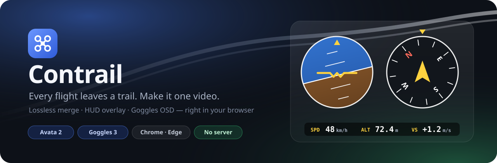
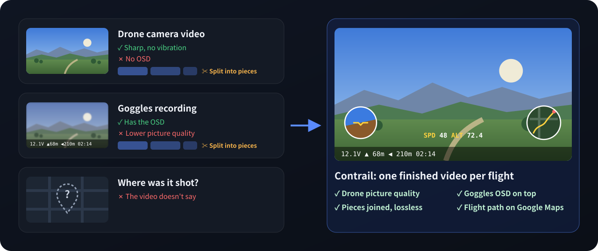
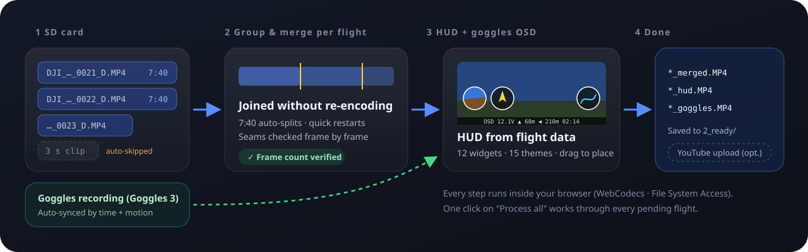
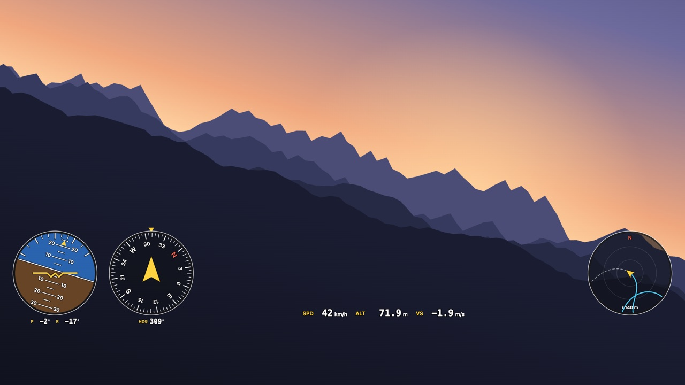
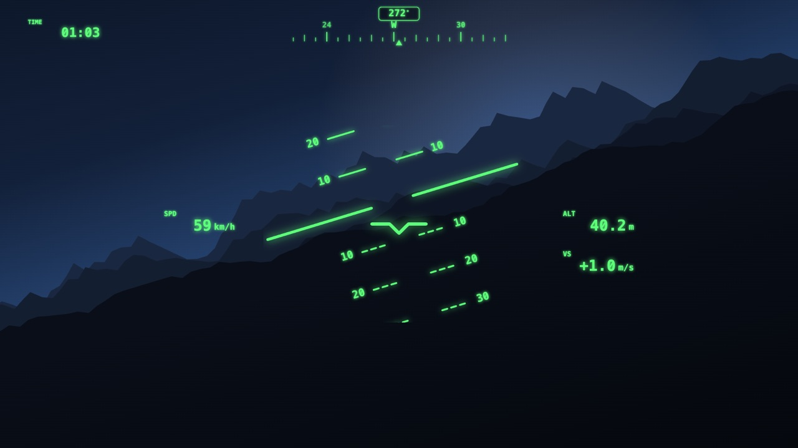
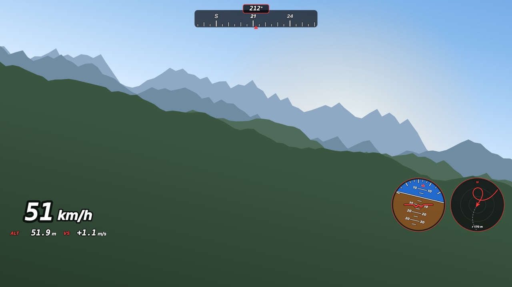
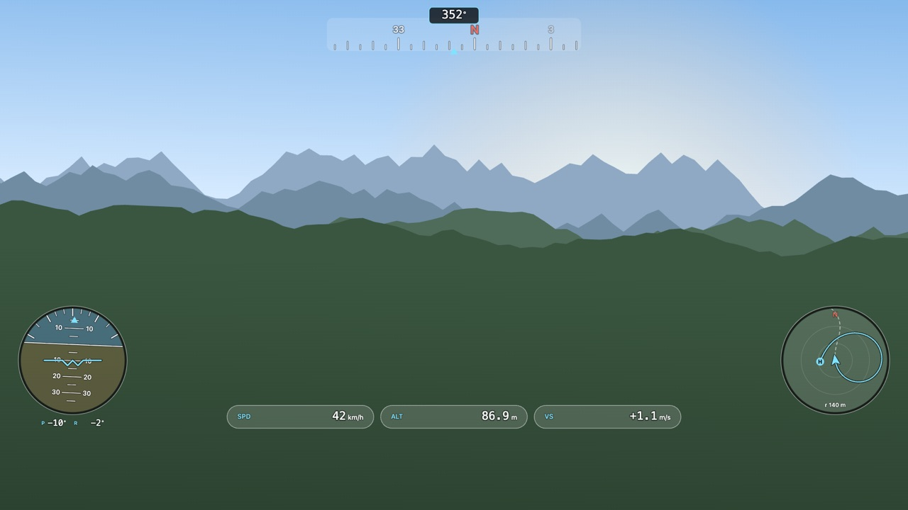
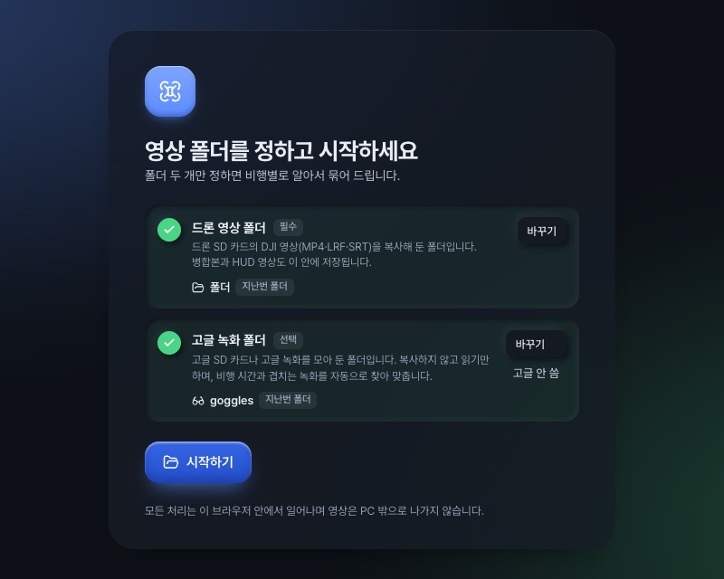

<p align="center">
  
</p>

<p align="center">
  <b>English</b> · <a href="README.ko.md">한국어</a> · <a href="README.zh.md">简体中文</a> · <a href="README.ja.md">日本語</a> · <a href="README.es.md">Español</a> · <a href="https://contrail.ouwork.io"><b>Open the app →</b></a>
</p>

<p align="center">
  
  
  
  
  
</p>

**Contrail** turns the trail your flight leaves behind into one finished video. It takes the clips scattered across your drone's SD card, **groups and joins them per flight**, **draws a HUD** from the flight data embedded in the video, and **composites the OSD from your goggles recording** on top.
There's nothing to install and no server. The browser reads and writes your local folder directly, and your footage never leaves your computer.

> The primary target is **DJI Avata 2 + DJI Goggles 3**. The app was built and verified on real recordings from both devices.
> Other aircraft and goggles may work if their files are structured similarly. Share a sample and we can widen support. See [Contributing](#contributing).

<br>

## Background

<p align="center">
  
</p>

I fly a DJI Avata 2 with Goggles 3, and every flight leaves me with two recordings, neither of them complete:

- **The drone's own video** is sharp and stabilized, with no vibration, but it has **no OSD**.
- **The goggles recording** has the OSD, but the picture is lower quality.
- **Both get split** once a recording runs past a certain length, so every flight has to be stitched back together by hand.
- **Nothing tells you where a video was shot.** I wanted the flight path drawn on a Google Maps minimap, so each video carries its own location.

Contrail does all of that in one pass: it joins the splits losslessly, lays the goggles OSD over the clean drone footage, and draws a HUD with a map trail from the flight data already stored inside the video.

<br>

## What it does

<p align="center">
  
</p>

- **Per-flight lossless merge.** It joins the 7:40 auto-split files and clips you restarted right away into one flight. No re-encoding, and the result is verified by frame count. You can inspect any seam and split or drop clips yourself.
- **HUD overlay.** Instruments are drawn from the attitude, heading, speed, altitude and GPS stored inside the video file. There are 12 widgets, 15 themes and 8 layout templates. You lay them out by dragging on the player, and they snap to edges, spacing and circle-to-circle tangency.
- **Goggles OSD.** Goggles 3 recordings are **synced automatically** by timestamp and motion correlation. Only the OSD is keyed out and laid over the full-quality drone footage, and stretches showing menus or warning dialogs are skipped.
- **Flight record summary.** It reads `DJIFlightRecord_*.txt` headers and pairs flight time, distance and max altitude/speed with each video. Only the header is read, since the body is encrypted.
- **Process all.** One button merges every pending flight and renders the HUD videos, one after another. You can cancel at any point, and a failed flight doesn't stop the rest.
- **YouTube upload (optional).** Hidden unless you turn it on in Settings.

<br>

## HUD gallery

<table>
  <tr>
    <td width="50%"><br><sub><b>Classic</b> · bottom gauges</sub></td>
    <td width="50%"><br><sub><b>Fighter HUD</b> · pitch ladder</sub></td>
  </tr>
  <tr>
    <td width="50%"><br><sub><b>Racing</b> · big speedo</sub></td>
    <td width="50%"><br><sub><b>Glass</b> · corners</sub></td>
  </tr>
</table>

<sub>These images were rendered by the app's real HUD code (`src/hud.ts`) using synthetic flight data over a drawn backdrop. With a Google Map Tiles API key, the minimap shows satellite imagery.</sub>

<br>

## Getting started



**You need:**
- Desktop **Chrome** or **Edge**. The app relies on the File System Access API and WebCodecs, so Firefox and Safari aren't supported yet.
- A folder containing the `DJI_*.MP4` files copied from the drone's SD card.
- Optionally, the goggles' SD card or a folder of goggles recordings.

**Steps:**
1. Open the app and pick your **drone footage folder**, plus the goggles folder if you have one.
2. Clips are grouped into flights. Open a flight to preview the merged result in the player.
3. Tune the instruments in the **HUD** tab and the OSD region in the **Goggles** tab. Changes save instantly, and Ctrl+Z undoes them.
4. Click **Merge and build overlay**, or **Process all** in the library.

Finished videos land in `2_ready/` inside your folder. Originals are never deleted; they're moved to `_sources/`.

<br clear="right">

<details>
<summary><b>Folder layout</b> (created by the app)</summary>

| Path | Meaning |
|---|---|
| `<folder>/` | Waiting to be merged. Copy `DJI_*.MP4/.LRF/.SRT` from the SD card here |
| `2_ready/` | Finished videos (`*_merged.MP4`, `*_hud.MP4`, `*_goggles.MP4`) + flight data `*.telemetry.json` |
| `3_uploaded/` | Videos already uploaded to YouTube (when upload is enabled) |
| `_sources/` | Originals used in a merge (never deleted) |
| `_excluded/` | Short clips that were skipped |
| `goggles/` | Goggles recordings (copied with "Add goggles videos", or dropped in by hand) |
| `FlightRecords/` | (optional) Flight records `DJIFlightRecord_*.txt` |
| `dji_state.json` | Manual choices, per-flight settings, goggles pairings |

</details>

<br>

## Privacy

- Video, flight data and location are processed **only inside your browser**. The app has no server.
- Only two things can make network requests, and both are opt-in:
  - **The satellite minimap** fetches map tiles for the flight area from Google once you add a Map Tiles API key.
  - **YouTube upload** sends the videos you choose once you enable it and connect a Google account.

<br>

## Development

```sh
pnpm install
pnpm dev        # http://localhost:5173
pnpm test       # unit tests (tests needing real footage run only when DJI_TEST_DIR is set)
pnpm build      # type-check + static build → dist/
```

`dist/` can be deployed to any static host that serves HTTPS. Copy `.env.example` to `.env` for default map and upload settings.
`VITE_` values are bundled verbatim, so **restrict API keys by HTTP referrer**. Users can also enter keys in the app's Settings.

<details>
<summary><b>Code tour</b></summary>

| File | What it does |
|---|---|
| `src/mp4.ts` | Minimal MP4 parser and muxer. Joins samples without re-encoding |
| `src/plan.ts` | Rules that group clips into flights and decide merges/exclusions (pure functions) |
| `src/telemetry.ts` | In-video `djmd` metadata (protobuf) → per-frame flight data |
| `src/hud.ts` · `src/map.ts` | HUD widgets, themes and minimap drawing |
| `src/render.ts` | WebCodecs decode → canvas compositing → H.264 encode → MP4 |
| `src/goggles.ts` · `src/sync.ts` | Goggles recording matching and time sync |
| `src/osdkey.ts` · `src/osdstat.ts` | Keeping only the OSD from the goggles picture |
| `src/flightlog.ts` | Flight record summary reader (v6–v14) |
| `src/snap.ts` | Snapping for the layout editor |
| `src/library.ts` · `src/store.ts` | Folder → flight model, state file |
| `src/ui/*` | Screens (Preact) |

</details>

The detailed behavior (grouping rules, goggles sync, OSD keying, render safeguards) is documented in Korean in [docs/ARCHITECTURE.md](docs/ARCHITECTURE.md).

<br>

## Contributing

Collaboration and contributions are **always welcome**, and they don't have to be code:

- **Samples from other aircraft or goggles** (Mini, Air, Mavic, Neo, Goggles 2, Goggles N3, …). Even one short recording helps.
- **Bug reports.** Include your browser version, aircraft and goggles models, and what you clicked. The "Copy error details" button on the app's error screen helps most.
- **Translations.** Korean and English ship today (`src/i18n.ts`).
- **HUD theme and widget ideas**, docs, and feedback.

See [CONTRIBUTING.md](CONTRIBUTING.md).

<br>

## Roadmap

- [ ] First-run guidance and an unsupported-browser notice
- [x] Public static deployment ([contrail.ouwork.io](https://contrail.ouwork.io))
- [ ] Support for more DJI aircraft and goggles
- [ ] Quick low-res preview render of the result
- [ ] Reading the flight record body (sticks, battery). Requires a DJI app key

<br>

## Acknowledgements

- [telemetry-parser](https://github.com/AdrianEddy/telemetry-parser) was the reference for DJI's `djmd` metadata layout.
- [dji-log-parser](https://github.com/lvauvillier/dji-log-parser) was the reference for the flight record format.
- [Pretendard](https://github.com/orioncactus/pretendard), [Lucide](https://lucide.dev) and [Preact](https://preactjs.com)

## License

[MIT](LICENSE)

DJI, Avata and DJI Goggles are trademarks of SZ DJI Technology Co., Ltd. This is an unofficial project and is not affiliated with DJI.
