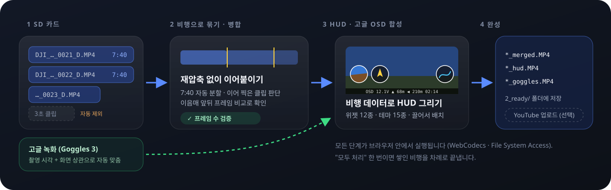

<p align="center">
  
</p>

<p align="center">
  <b>한국어</b> · <a href="README.en.md">English</a>
</p>

<p align="center">
  
  
  
  
  
</p>

**드론 라이브러리**는 SD 카드에 흩어진 드론 영상을 **비행 단위로 묶어 이어붙이고**, 영상 속 비행 데이터로 **HUD 계기판을 입히고**, **고글 녹화의 OSD**까지 합성해 주는 웹앱입니다.
설치도 서버도 없습니다. 브라우저가 내 PC의 폴더를 직접 읽고 쓰며, 영상은 PC 밖으로 나가지 않습니다.

> 기본 대상은 **DJI Avata 2 + DJI Goggles 3** 입니다. 두 기기의 실제 녹화로 만들고 검증했습니다.
> 다른 기체·고글도 영상 구조가 비슷하면 동작할 수 있습니다. 샘플을 나눠 주시면 지원을 넓힐 수 있어요. [기여하기](#기여하기)

<br>

## 무엇을 해 주나요

<p align="center">
  
</p>

| | |
|---|---|
| **비행 단위 자동 병합** | 7분 40초마다 잘리는 분할 영상과 잠깐 멈췄다 이어 찍은 클립을 알아서 한 비행으로 묶습니다. **재압축 없이** 이어붙이고 프레임 수로 검증하니 화질 손실이 없습니다. 이음매 앞뒤 프레임을 보고 직접 나누거나 뺄 수도 있습니다. |
| **HUD 오버레이** | 영상 파일 안에 기록된 자세·방위·속도·고도·GPS로 계기판을 그립니다. 위젯 12종, 테마 15종, 배치 템플릿 8종. 플레이어 위에서 끌어서 배치하면 가장자리·간격·원끼리 맞닿기까지 스냅됩니다. |
| **고글 OSD 합성** | Goggles 3 녹화를 촬영 시각과 화면 움직임으로 **자동으로 맞춘 뒤**, 고글 화면의 OSD만 오려 내 드론 원본 화질 영상에 얹습니다. 메뉴·경고창이 뜬 구간은 알아서 뺍니다. |
| **비행기록 요약** | `FlightRecords` 의 비행기록 파일을 읽어 비행 시간·거리·최고 고도/속도를 영상과 짝지어 보여 줍니다 (본문은 암호화돼 있어 요약만 읽습니다). |
| **모두 처리** | 쌓인 비행을 버튼 하나로 차례로 병합하고 HUD 영상까지 만듭니다. 중간에 멈춰도, 하나가 실패해도 안전합니다. |
| **YouTube 업로드 (선택)** | 설정에서 켜면 완성 영상을 바로 올립니다. 끄면 화면에 나타나지도 않습니다. |

<br>

## HUD 미리보기

<table>
  <tr>
    <td width="50%"><br><sub><b>클래식</b> · 하단 계기</sub></td>
    <td width="50%"><br><sub><b>전투기 HUD</b> · 피치 사다리</sub></td>
  </tr>
  <tr>
    <td width="50%"><br><sub><b>레이싱</b> · 큰 속도계</sub></td>
    <td width="50%"><br><sub><b>글라스</b> · 모서리 배치</sub></td>
  </tr>
</table>

<sub>위 그림은 앱의 실제 HUD 그리기 코드(`src/hud.ts`)에 가상의 비행 데이터를 넣어 만든 것입니다. 배경 풍경은 그림이며, 실제 영상에서는 위성 지도 미니맵도 쓸 수 있습니다 (Google Map Tiles API 키 필요).</sub>

<br>

## 시작하기


**필요한 것**
- 데스크톱 **Chrome** 또는 **Edge** (폴더를 직접 읽고 쓰는 File System Access API와 WebCodecs가 필요합니다. Firefox·Safari는 아직 지원하지 않습니다)
- 드론 SD 카드의 `DJI_*.MP4` 영상을 복사해 둔 폴더
- (선택) 고글 SD 카드나 고글 녹화를 모아 둔 폴더

**사용 순서**
1. 앱을 열고 **드론 영상 폴더**를 고릅니다. 고글 녹화 폴더도 있으면 함께 고릅니다.
2. 앱이 클립을 비행별로 묶어 보여 줍니다. 비행을 열면 큰 플레이어로 병합 결과를 미리 볼 수 있습니다.
3. **HUD** 탭에서 계기판을, **고글** 탭에서 OSD 영역을 손봅니다. 바꾼 내용은 바로 저장됩니다 (Ctrl+Z 되돌리기).
4. **병합하고 오버레이 만들기** 또는 라이브러리의 **모두 처리**를 누릅니다.

완성 영상은 폴더 안의 `2_ready/` 에 쌓입니다. 원본은 지우지 않고 `_sources/` 로 옮겨 둡니다.

<br clear="right">

<details>
<summary><b>폴더 구조</b> (앱이 자동으로 만듭니다)</summary>

| 위치 | 의미 |
|---|---|
| `<폴더>/` | 병합 대기. SD 카드의 `DJI_*.MP4/.LRF/.SRT` 를 여기에 복사 |
| `2_ready/` | 완성 영상 (`*_merged.MP4`, `*_hud.MP4`, `*_goggles.MP4`) + 비행 데이터 `*.telemetry.json` |
| `3_uploaded/` | YouTube 업로드를 마친 영상 (업로드 기능을 켰을 때) |
| `_sources/` | 병합에 쓰인 원본 (지우지 않음) |
| `_excluded/` | 제외한 짧은 클립 |
| `goggles/` | 고글 녹화 ("고글 영상 추가"로 복사하거나 직접 넣기) |
| `FlightRecords/` | (선택) 비행기록 `DJIFlightRecord_*.txt` |
| `dji_state.json` | 수동 선택, 비행별 설정, 고글 연결 기록 |

</details>

<br>

## 개인정보

- 영상, 비행 데이터, 위치는 **브라우저 안에서만** 처리합니다. 이 앱에는 서버가 없습니다.
- 바깥으로 나가는 요청은 두 가지뿐이며, 둘 다 직접 켰을 때만 일어납니다.
  - **위성 지도 미니맵**: Google Map Tiles API 키를 넣으면 비행 지역의 지도 타일을 Google에서 받아 옵니다.
  - **YouTube 업로드**: 업로드를 켜고 Google 계정을 연결하면 고른 영상을 YouTube로 보냅니다.

<br>

## 개발

```sh
pnpm install
pnpm dev        # http://localhost:5173
pnpm test       # 단위 테스트 (실제 영상이 필요한 테스트는 DJI_TEST_DIR 이 있을 때만 실행)
pnpm build      # 타입 검사 + 정적 빌드 → dist/
```

`dist/` 는 아무 정적 호스팅에나 올리면 됩니다 (HTTPS 필요). `.env.example` 을 참고해 `.env` 를 만들면 지도·업로드 기본값을 넣을 수 있습니다.
`VITE_` 값은 번들에 그대로 들어가므로 **API 키는 반드시 HTTP 리퍼러 제한**을 거세요. 키 없이도 앱 설정 화면에서 입력할 수 있습니다.

<details>
<summary><b>코드 둘러보기</b></summary>

| 파일 | 하는 일 |
|---|---|
| `src/mp4.ts` | 최소 MP4 파서·병합기. 재인코딩 없이 샘플만 이어붙임 |
| `src/plan.ts` | 클립을 비행으로 묶고 병합·제외를 정하는 규칙 (순수 함수) |
| `src/telemetry.ts` | 영상 안 `djmd` 메타데이터(protobuf) → 프레임별 비행 데이터 |
| `src/hud.ts` · `src/map.ts` | HUD 위젯·테마·미니맵 그리기 |
| `src/render.ts` | WebCodecs 디코드 → 캔버스 합성 → H.264 인코드 → MP4 |
| `src/goggles.ts` · `src/sync.ts` | 고글 녹화 매칭·시간 동기화 |
| `src/osdkey.ts` · `src/osdstat.ts` | 고글 화면에서 OSD만 남기기 |
| `src/flightlog.ts` | 비행기록 요약 읽기 (v6~v14) |
| `src/snap.ts` | 배치 편집 스냅 |
| `src/library.ts` · `src/store.ts` | 폴더 → 비행 모델, 상태 파일 |
| `src/ui/*` | 화면 (Preact) |

자동 판단 규칙, 고글 동기화, OSD 키잉, 렌더 안정 장치 같은 세부 동작은 [docs/ARCHITECTURE.md](docs/ARCHITECTURE.md) 에 있습니다.

</details>

<br>

## 기여하기

협업과 기여는 **언제든 환영합니다**. 코드가 아니어도 좋습니다.

- **다른 기체·고글 샘플**: Avata 2 / Goggles 3 밖의 기종(Mini, Air, Mavic, Neo, Goggles 2, Goggles N3 등)은 짧은 녹화 하나만 있어도 지원을 넓힐 수 있습니다.
- **버그 제보**: 브라우저 버전, 기체·고글 모델, 무엇을 눌렀는지 적어 주세요. 앱의 오류 화면에 있는 "오류 내용 복사"를 붙여 주시면 가장 빠릅니다.
- **번역**: 지금은 한국어·영어를 지원합니다 (`src/i18n.ts`).
- **HUD 테마·위젯 아이디어**, 문서 개선, 사용 후기도 모두 반갑습니다.

자세한 방법은 [CONTRIBUTING.md](CONTRIBUTING.md) 를 봐 주세요.

<br>

## 앞으로

- [ ] 처음 쓰는 사람을 위한 안내와 지원하지 않는 브라우저 안내
- [ ] 정적 호스팅 공개 배포
- [ ] 다른 DJI 기체·고글 지원 확대
- [ ] 결과 영상 짧은 미리보기 렌더
- [ ] 비행기록 본문(스틱·배터리) 읽기. DJI 키 발급이 필요합니다

<br>

## 감사의 말

- [telemetry-parser](https://github.com/AdrianEddy/telemetry-parser): DJI `djmd` 메타데이터 구조 참고
- [dji-log-parser](https://github.com/lvauvillier/dji-log-parser): 비행기록 형식 참고
- [Pretendard](https://github.com/orioncactus/pretendard), [Lucide](https://lucide.dev), [Preact](https://preactjs.com)

## 라이선스

[MIT](LICENSE)

DJI, Avata, DJI Goggles는 SZ DJI Technology Co., Ltd.의 상표입니다. 이 프로젝트는 DJI와 관련이 없는 비공식 도구입니다.
