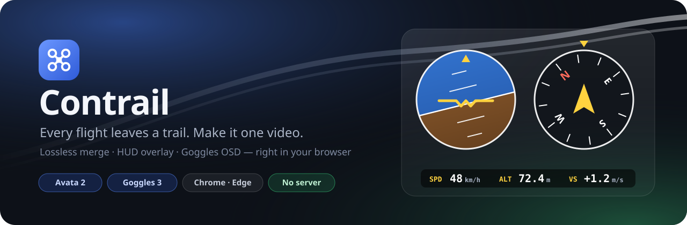
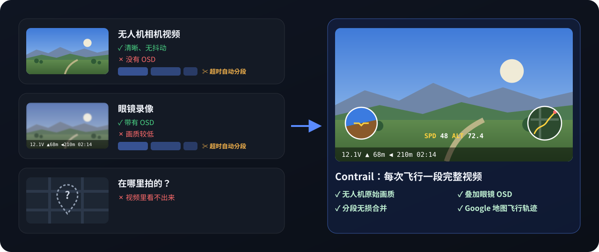
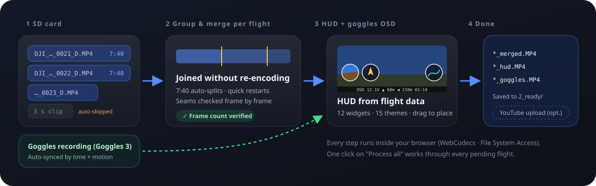
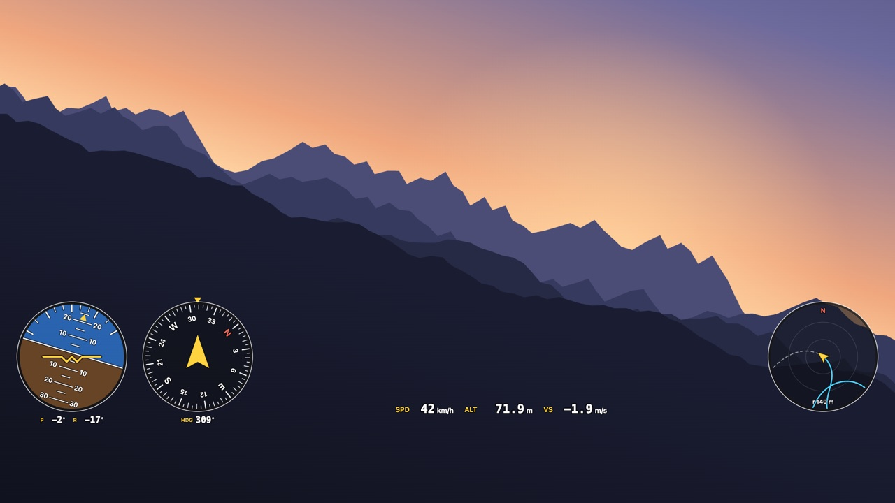
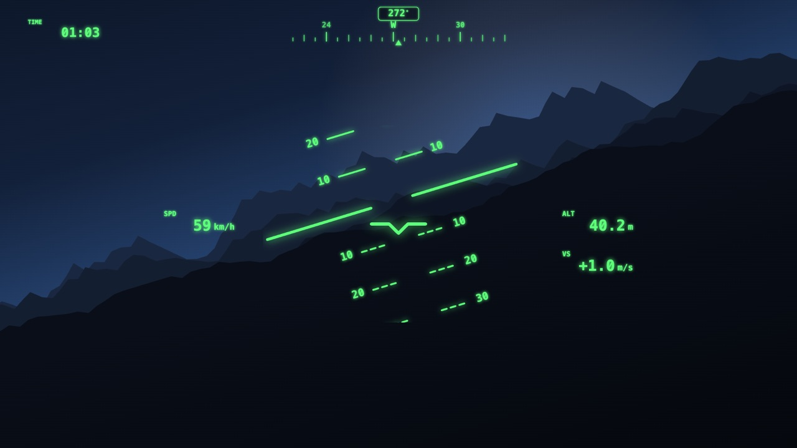
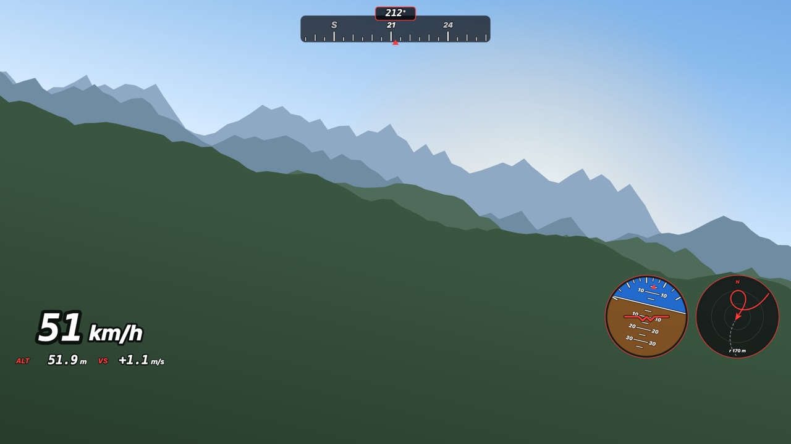
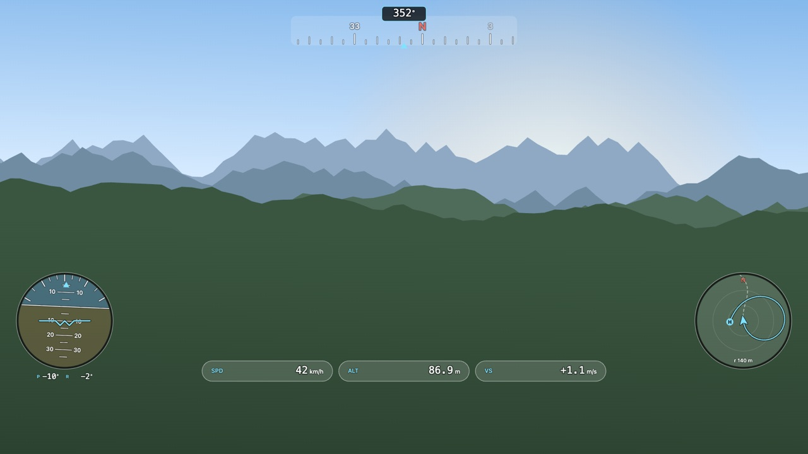
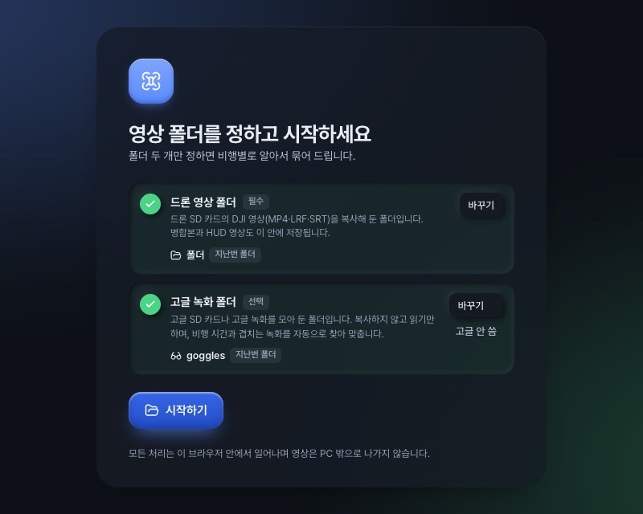

<p align="center">
  
</p>

<p align="center">
  <a href="README.md">English</a> · <a href="README.ko.md">한국어</a> · <b>简体中文</b> · <a href="README.ja.md">日本語</a> · <a href="README.es.md">Español</a> · <a href="https://contrail.ouwork.io"><b>打开应用 →</b></a>
</p>

<p align="center">
  
  
  
  
  
</p>

**Contrail**（意为“飞机尾迹云”）把每次飞行留下的痕迹变成一段完整的视频。它把散落在无人机 SD 卡里的片段**按飞行分组并拼接**，用视频内嵌的飞行数据**绘制 HUD 仪表**，再把**眼镜录像中的 OSD** 叠加上去。
无需安装，也没有服务器。浏览器直接读写你电脑上的文件夹，视频不会离开你的电脑。

> 主要支持 **DJI Avata 2 + DJI Goggles 3**，并已用这两款设备的真实录像开发和验证。
> 其他机型和眼镜只要文件结构相似也可能可用。欢迎提供样片，帮助我们扩大支持范围，详见[参与贡献](#参与贡献)。

<br>

## 背景

<p align="center">
  
</p>

我用 DJI Avata 2 搭配 Goggles 3 飞行，每次飞完都会留下两份录像，但哪一份都不完整：

- **无人机自身的视频**清晰稳定、没有抖动，但**没有 OSD**。
- **眼镜录像**有 OSD，但画质较低。
- **两者**在录制超过一定时长后都会**被自动分段**，每次飞行都得手动拼回去。
- **视频本身看不出是在哪里拍的。** 我希望在 Google 地图小地图上留下飞行轨迹，让每段视频都带着自己的位置。

Contrail 一次完成这些工作：无损拼接分段文件，把眼镜 OSD 叠加到清晰的无人机画面上，并利用视频里已经记录的飞行数据绘制带地图轨迹的 HUD。

<br>

## 功能

<p align="center">
  
</p>

- **按飞行无损合并。** 把每 7:40 自动切分的文件和中途短暂停止后重新录制的片段合并成一次飞行。不重新编码，并用帧数校验结果。你可以检查任意接缝，自行拆分或排除片段。
- **HUD 叠加。** 根据视频文件内记录的姿态、航向、速度、高度和 GPS 绘制仪表。提供 12 种组件、15 种主题和 8 种布局模板。在播放器上拖动即可摆放，并会吸附到边缘、间距以及圆与圆的相切位置。
- **眼镜 OSD。** 根据拍摄时间和画面运动相关性**自动同步** Goggles 3 录像，只抠出 OSD 叠加到原画质的无人机画面上，并自动跳过出现菜单或警告弹窗的片段。
- **飞行记录摘要。** 读取 `DJIFlightRecord_*.txt` 的文件头，把飞行时间、距离、最大高度/速度与对应视频配对显示。正文是加密的，因此只读取文件头。
- **全部处理。** 一个按钮依次合并所有待处理的飞行并渲染 HUD 视频。随时可以取消，某次飞行失败也不会影响其余飞行。
- **YouTube 上传（可选）。** 只有在设置中开启后才会显示。

<br>

## HUD 预览

<table>
  <tr>
    <td width="50%"><br><sub><b>经典</b> · 底部仪表</sub></td>
    <td width="50%"><br><sub><b>战斗机 HUD</b> · 俯仰梯</sub></td>
  </tr>
  <tr>
    <td width="50%"><br><sub><b>竞速</b> · 大号速度表</sub></td>
    <td width="50%"><br><sub><b>玻璃</b> · 四角布局</sub></td>
  </tr>
</table>

<sub>以上图片由应用真实的 HUD 绘制代码（`src/hud.ts`）配合模拟飞行数据和手绘背景生成。填入 Google Map Tiles API 密钥后，小地图会显示卫星图像。</sub>

<br>

## 快速开始



**你需要：**
- 桌面版 **Chrome** 或 **Edge**。应用依赖 File System Access API 和 WebCodecs，暂不支持 Firefox 和 Safari。
- 一个存放从无人机 SD 卡复制出来的 `DJI_*.MP4` 文件的文件夹。
- （可选）眼镜的 SD 卡，或存放眼镜录像的文件夹。

**步骤：**
1. 打开应用，选择**无人机视频文件夹**；如果有眼镜录像文件夹，也一并选择。
2. 片段会按飞行分组。打开某次飞行，即可在播放器中预览合并结果。
3. 在 **HUD** 标签页调整仪表，在**眼镜**标签页调整 OSD 区域。修改会立即保存，可用 Ctrl+Z 撤销。
4. 点击**合并并生成叠加**，或在资料库中点击**全部处理**。

完成的视频会保存在文件夹内的 `2_ready/`。原始文件不会被删除，而是移动到 `_sources/`。

<br clear="right">

<details>
<summary><b>文件夹结构</b>（由应用自动创建）</summary>

| 位置 | 含义 |
|---|---|
| `<文件夹>/` | 等待合并。把 SD 卡中的 `DJI_*.MP4/.LRF/.SRT` 复制到这里 |
| `2_ready/` | 完成的视频（`*_merged.MP4`、`*_hud.MP4`、`*_goggles.MP4`）+ 飞行数据 `*.telemetry.json` |
| `3_uploaded/` | 已上传到 YouTube 的视频（开启上传功能时） |
| `_sources/` | 合并所用的原始文件（不会删除） |
| `_excluded/` | 被排除的短片段 |
| `goggles/` | 眼镜录像（通过“添加眼镜视频”复制，或手动放入） |
| `FlightRecords/` | （可选）飞行记录 `DJIFlightRecord_*.txt` |
| `dji_state.json` | 手动选择、每次飞行的设置、眼镜配对记录 |

</details>

<br>

## 隐私

- 视频、飞行数据和位置**只在你的浏览器内**处理。应用没有服务器。
- 只有两项功能会发起网络请求，并且都需要你主动开启：
  - **卫星小地图**：填入 Map Tiles API 密钥后，会从 Google 获取飞行区域的地图瓦片。
  - **YouTube 上传**：开启上传并连接 Google 账号后，会把你选择的视频发送到 YouTube。

<br>

## 开发

```sh
pnpm install
pnpm dev        # http://localhost:5173
pnpm test       # 单元测试（需要真实视频的测试仅在设置 DJI_TEST_DIR 时运行）
pnpm build      # 类型检查 + 静态构建 → dist/
```

`dist/` 可以部署到任何支持 HTTPS 的静态托管服务。参照 `.env.example` 创建 `.env`，即可设置地图和上传的默认值。
`VITE_` 变量会原样打包进产物，因此**务必为 API 密钥设置 HTTP 引荐来源限制**。用户也可以在应用的设置页面中输入密钥。

<details>
<summary><b>代码导览</b></summary>

| 文件 | 作用 |
|---|---|
| `src/mp4.ts` | 精简的 MP4 解析与封装器，不重新编码，只拼接样本 |
| `src/plan.ts` | 把片段分组为飞行并决定合并/排除的规则（纯函数） |
| `src/telemetry.ts` | 视频内 `djmd` 元数据（protobuf）→ 逐帧飞行数据 |
| `src/hud.ts` · `src/map.ts` | HUD 组件、主题和小地图绘制 |
| `src/render.ts` | WebCodecs 解码 → 画布合成 → H.264 编码 → MP4 |
| `src/goggles.ts` · `src/sync.ts` | 眼镜录像匹配与时间同步 |
| `src/osdkey.ts` · `src/osdstat.ts` | 从眼镜画面中只保留 OSD |
| `src/flightlog.ts` | 飞行记录摘要读取（v6–v14） |
| `src/snap.ts` | 布局编辑器的吸附 |
| `src/library.ts` · `src/store.ts` | 文件夹 → 飞行模型、状态文件 |
| `src/ui/*` | 界面（Preact） |

</details>

分组规则、眼镜同步、OSD 抠像、渲染保护等详细行为见 [docs/ARCHITECTURE.md](docs/ARCHITECTURE.md)（韩文）。

<br>

## 参与贡献

**随时欢迎**协作与贡献，不一定是代码：

- **其他机型或眼镜的样片**（Mini、Air、Mavic、Neo、Goggles 2、Goggles N3 等）。哪怕只有一段短录像也很有帮助。
- **问题反馈。** 请注明浏览器版本、机型和眼镜型号以及你的操作步骤。附上应用错误页面中“复制错误详情”的内容最有帮助。
- **翻译。** 应用界面目前支持韩语和英语（`src/i18n.ts`）。
- **HUD 主题和组件创意**、文档改进和使用反馈。

详见 [CONTRIBUTING.md](CONTRIBUTING.md)。

<br>

## 路线图

- [ ] 新手引导和不支持的浏览器提示
- [x] 公开静态部署（[contrail.ouwork.io](https://contrail.ouwork.io)）
- [ ] 支持更多 DJI 机型和眼镜
- [ ] 结果视频的快速低清预览渲染
- [ ] 读取飞行记录正文（摇杆、电池）。需要 DJI 应用密钥

<br>

## 致谢

- [telemetry-parser](https://github.com/AdrianEddy/telemetry-parser)：DJI `djmd` 元数据结构参考
- [dji-log-parser](https://github.com/lvauvillier/dji-log-parser)：飞行记录格式参考
- [Pretendard](https://github.com/orioncactus/pretendard)、[Lucide](https://lucide.dev)、[Preact](https://preactjs.com)

## 许可证

[MIT](LICENSE)

DJI、Avata 和 DJI Goggles 是 SZ DJI Technology Co., Ltd. 的商标。本项目为非官方工具，与 DJI 无关。
